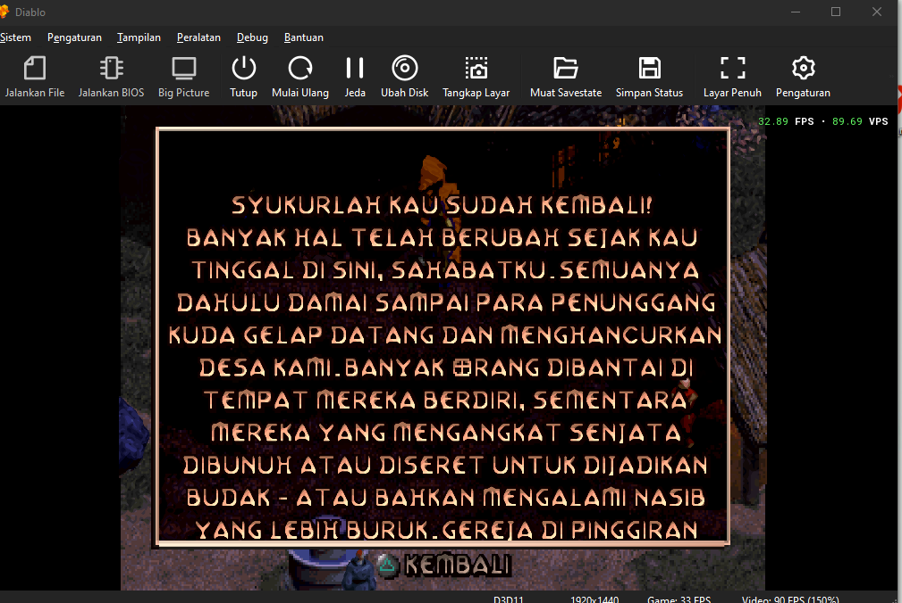
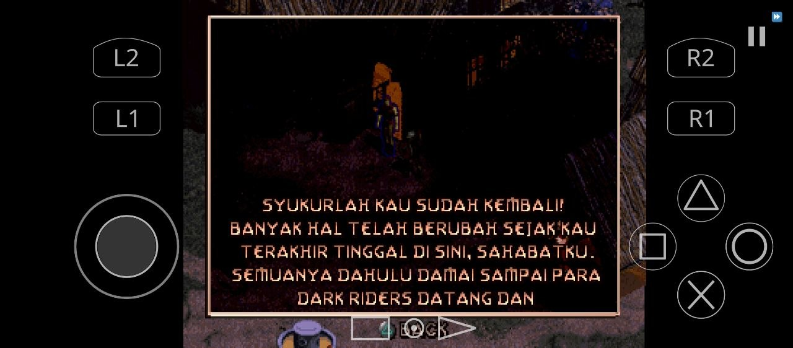
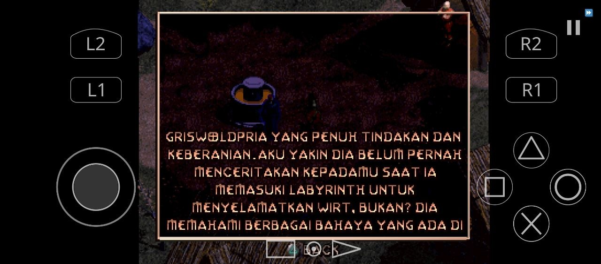
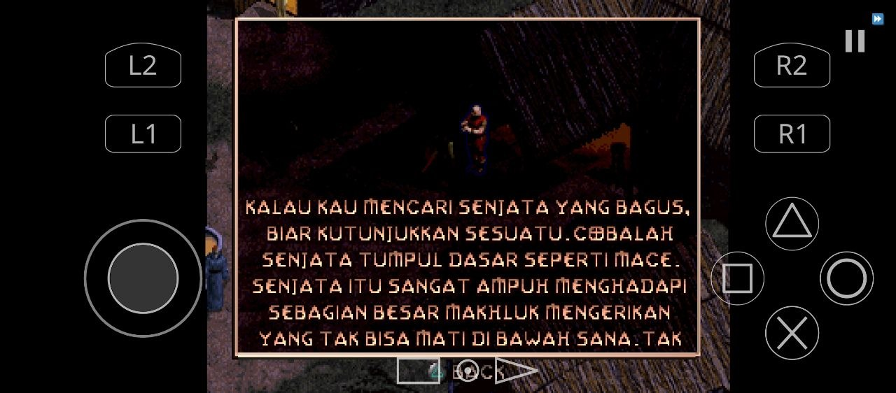

# Diablo PS1 – Story Edition Indonesia 🇮🇩

**Patch terjemahan Bahasa Indonesia untuk Diablo versi PlayStation 1.**

Proyek fan translation independen oleh **Gninx**.

Proyek ini bertujuan menghadirkan pengalaman memahami cerita Diablo PS1 dalam Bahasa Indonesia, termasuk dialog NPC, narasi cerita, History, dan Lore.

## 🎮 Tentang Proyek

Diablo merupakan game action RPG klasik yang menghadirkan dunia gelap, karakter, cerita, dan berbagai informasi sejarah dunia game.

Melalui **Diablo PS1 – Story Edition Indonesia**, elemen cerita diterjemahkan ke Bahasa Indonesia agar lebih mudah dipahami oleh pemain Indonesia.

### Fokus penerjemahan
- Dialog dan percakapan NPC.
- Cerita dan narasi game.
- History dan Lore.
- Informasi pendukung cerita yang termasuk dalam cakupan Story Edition.

Menu utama, identitas visual, dan nama item original tetap dipertahankan.

## 📥 Download Patch

**File:** `Diablo_PS1_Story_Edition.xdelta`

**[DOWNLOAD PATCH DI SINI](patch/Diablo_PS1_Story_Edition.xdelta)**

Ukuran: 202.697 bytes  
Format: XDELTA3  
Platform: PlayStation 1  
Bahasa: Indonesia

**Penting:** Patch ini bukan game lengkap. Kamu harus memiliki file dump Diablo PS1 original yang sesuai dengan versi sumber patch.

Nama game yang sama belum tentu menjamin kompatibilitas. Perbedaan region, revisi, atau isi dump dapat menyebabkan proses patch gagal.

## 📸 Screenshot Hasil Terjemahan

Berikut dokumentasi hasil penerjemahan di dalam game.









---

# 🧰 TOOLS YANG DIBUTUHKAN

## Android

1. **UniPatcher** – aplikasi untuk memasang patch XDELTA.
   - [Google Play – UniPatcher](https://play.google.com/store/apps/details?id=org.emunix.unipatcher)
   - [Website UniPatcher](https://unipatcher.com/)

2. **DuckStation** – emulator PlayStation 1.
   - [Google Play – DuckStation](https://play.google.com/store/apps/details?id=com.github.stenzek.duckstation)

3. File Manager – untuk mengatur file BIN, CUE, dan XDELTA.

## Windows PC

1. **Xdelta3** – program untuk menerapkan patch melalui PowerShell atau Command Prompt.
   - [Download Xdelta3 – GitHub Releases](https://github.com/jmacd/xdelta/releases)

2. **DuckStation** – emulator PlayStation 1.
   - [Download DuckStation – GitHub Releases](https://github.com/stenzek/duckstation/releases/latest)

---

# 📱 TUTORIAL PEMASANGAN PATCH ANDROID

## 1. Persiapkan file

Siapkan tiga file berikut di HP:

| Nama file | Keterangan |
|---|---|
| `Diablo.bin` | File BIN game original |
| `Diablo.cue` | File CUE original |
| `Diablo_PS1_Story_Edition.xdelta` | Patch terjemahan |

Pastikan BIN yang digunakan sesuai dengan versi sumber patch.

Jika file XDELTA berada di dalam ZIP atau RAR, ekstrak terlebih dahulu.

## 2. Install UniPatcher

1. Buka Google Play.
2. Cari UniPatcher.
3. Install aplikasi.
4. Download patch dari repository ini.
5. Pastikan file XDELTA sudah tersedia dan tidak berada di dalam arsip ZIP/RAR.

## 3. Terapkan patch dengan UniPatcher

Buka aplikasi UniPatcher.

Pilih file pada tiga bagian berikut:

**Patch file:**

`Diablo_PS1_Story_Edition.xdelta`

**ROM file:**

`Diablo.bin`

**Output file:**

`Diablo_Story_Edition.bin`

Setelah semuanya dipilih:

1. Periksa kembali file yang dipilih.
2. Tekan tombol bulat merah untuk memulai proses.
3. Tunggu hingga proses selesai.
4. Pastikan UniPatcher menampilkan pemberitahuan bahwa patch berhasil diterapkan.

Jangan menimpa BIN original. Simpan hasil patch sebagai file baru.

## 4. Buat file CUE baru

Setelah proses patch berhasil, buat file teks baru dengan nama:

`Diablo_Story_Edition.cue`

Masukkan isi berikut:

```cue
FILE "Diablo_Story_Edition.bin" BINARY
  TRACK 01 MODE2/2352
    INDEX 01 00:00:00
```

Simpan file CUE di folder yang sama dengan BIN hasil patch.

Pastikan nama BIN pada file CUE sama persis dengan nama file hasil patch.

Struktur folder:

```text
Diablo Story Edition/
├── Diablo_Story_Edition.bin
└── Diablo_Story_Edition.cue
```

## 5. Jalankan melalui DuckStation

1. Install dan buka DuckStation.
2. Ikuti pengaturan awal emulator.
3. Tambahkan folder Diablo Story Edition ke direktori game.
4. Cari game hasil patch.
5. Pilih file `Diablo_Story_Edition.cue`.
6. Jalankan game.

Selesai! Diablo PS1 Story Edition Indonesia siap dimainkan.

---

# 💻 TUTORIAL PEMASANGAN PATCH WINDOWS PC

## 1. Persiapkan file

Buat folder baru dengan nama:

`Diablo Story Edition`

Masukkan ketiga file berikut ke dalam folder:

```text
Diablo Story Edition/
├── Diablo.bin
├── Diablo_PS1_Story_Edition.xdelta
└── xdelta3.exe
```

Keterangan:
- `Diablo.bin` adalah file original.
- `Diablo_PS1_Story_Edition.xdelta` adalah patch.
- `xdelta3.exe` adalah program untuk memasang patch.

## 2. Download Xdelta3

1. Buka halaman GitHub Xdelta3.
2. Kunjungi [GitHub Releases](https://github.com/jmacd/xdelta/releases).
3. Download paket Windows sesuai arsitektur PC.
4. Ekstrak file ZIP.
5. Letakkan executable Xdelta3 di folder Diablo Story Edition.
6. Sesuaikan nama executable menjadi `xdelta3.exe` agar sesuai dengan perintah berikut.

## 3. Jalankan proses patch

1. Buka folder Diablo Story Edition.
2. Klik kanan area kosong.
3. Pilih Open in Terminal atau buka PowerShell di folder tersebut.
4. Jalankan perintah berikut:

```powershell
.\xdelta3.exe -d -s ".\Diablo.bin" ".\Diablo_PS1_Story_Edition.xdelta" ".\Diablo_Story_Edition.bin"
```

Tunggu hingga proses selesai.

Jika tidak terdapat error dan proses berhasil, file berikut akan terbentuk:

`Diablo_Story_Edition.bin`

Jangan menghapus file BIN original sebelum hasil patch selesai diverifikasi.

## 4. Buat file CUE baru

Buat file teks baru:

`Diablo_Story_Edition.cue`

Isi dengan kode berikut:

```cue
FILE "Diablo_Story_Edition.bin" BINARY
  TRACK 01 MODE2/2352
    INDEX 01 00:00:00
```

Simpan di folder yang sama dengan BIN hasil patch.

Pastikan ekstensi file benar-benar `.cue`, bukan `.cue.txt`.

## 5. Jalankan melalui DuckStation

1. Download DuckStation dari [GitHub Releases](https://github.com/stenzek/duckstation/releases/latest).
2. Install emulator.
3. Jalankan DuckStation.
4. Ikuti pengaturan awal.
5. Tambahkan folder Diablo Story Edition ke direktori game.
6. Pilih `Diablo_Story_Edition.cue`.
7. Jalankan game.

Selesai! Diablo PS1 Story Edition Indonesia siap dimainkan di Windows PC.

---

# ❓ TROUBLESHOOTING

### UniPatcher gagal menerapkan patch

Kemungkinan penyebab:
- BIN original tidak sesuai dengan sumber patch.
- File XDELTA rusak.
- Patch belum diekstrak dari arsip.
- Versi atau revisi game berbeda.

Periksa kembali file sumber dan patch yang digunakan.

### Xdelta3 menampilkan error

Periksa:
- Nama file.
- Lokasi file.
- File BIN original.
- File patch XDELTA.
- Perintah PowerShell yang digunakan.

Jangan gunakan file hasil patch jika proses berakhir dengan error.

### Game tidak terdeteksi di DuckStation

Pastikan:
- BIN hasil patch tersedia.
- CUE tersedia.
- Kedua file berada dalam folder yang sama.
- Nama BIN pada CUE sesuai dengan file hasil patch.

Gunakan file CUE untuk menjalankan game.

### DuckStation meminta BIOS

DuckStation membutuhkan BIOS PlayStation untuk menjalankan game. BIOS tidak disertakan dengan emulator. Gunakan BIOS hasil dump dari konsol milik sendiri.

---

# ❤️ DUKUNG PROYEK G N I N X

Proyek ini dibuat secara independen untuk membantu komunitas Indonesia menikmati cerita game klasik dalam Bahasa Indonesia.

Apabila kamu menikmati hasil proyek ini dan ingin memberikan dukungan sukarela untuk pengembangan proyek penerjemahan game lainnya, kamu dapat memberikan dukungan melalui Saweria.

**Saweria:** [Dukung Gninx melalui Saweria](https://saweria.co/gninx)

Dukungan tidak diwajibkan. Terima kasih kepada semua pemain yang telah mencoba dan mendukung proyek ini.

---

# ⚖️ DISCLAIMER

Diablo merupakan properti intelektual dari pemilik hak cipta dan merek dagangnya masing-masing.

Diablo PS1 – Story Edition Indonesia adalah proyek fan translation independen dan tidak berafiliasi, disponsori, atau didukung secara resmi oleh pemilik Diablo maupun Sony.

Repository ini hanya menyediakan patch terjemahan dalam format XDELTA. File game original, BIN, ISO, CUE komersial, dan BIOS tidak disertakan.

Pengguna harus menyediakan dump game dan BIOS sendiri sesuai ketentuan yang berlaku.

---

**Project:** Diablo PS1 – Story Edition Indonesia  
**Translator:** Gninx  
**Platform:** PlayStation 1  
**Patch Format:** XDELTA3  
**Android Patcher:** UniPatcher  
**PC Patcher:** Xdelta3  
**Emulator:** DuckStation  
**Language:** Bahasa Indonesia

© Gninx
